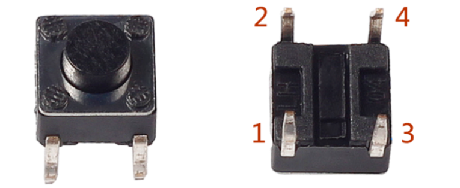
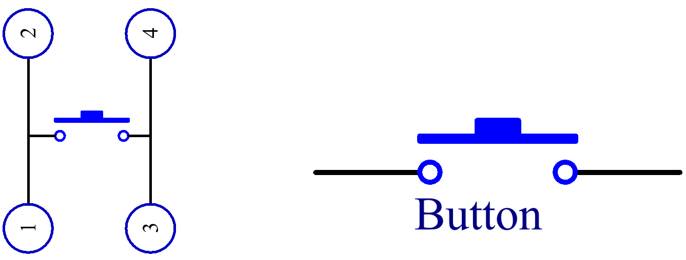
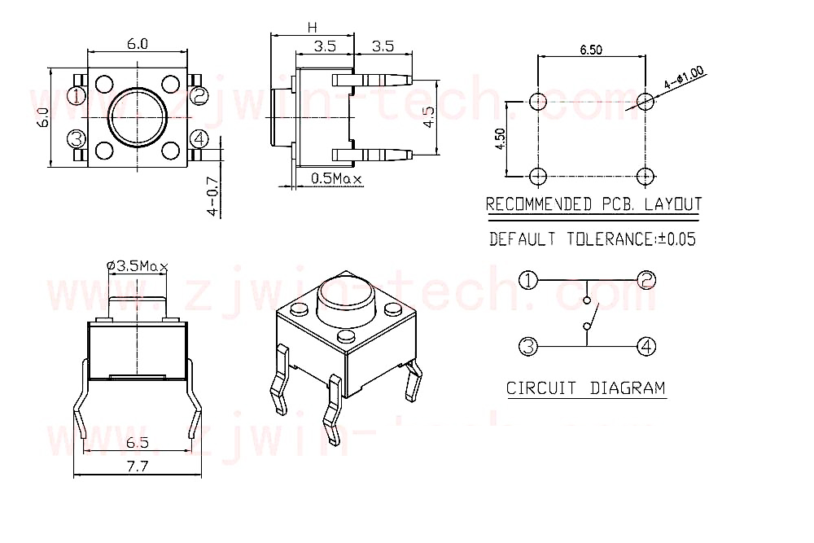

# Button

Buttons are a common component used to control electronic devices, they are usually used as switches to connect or break circuits.

The following is the internal structure of a button. The symbol on the right below is usually used to represent a button in circuits.

Since the pin 1 is connected to pin 2, and pin 3 to pin 4, when the button is pressed, the 4 pins are connected, thus closing the circuit.

**Example**

- `button_mega` (Mega Board Project)

- `answer_mega` (Mega Board Project)

- `button_uno` (R3 Board Project)

- `answer_uno` (R3 Board Project)

- `7. Doorbell` (Scratch Project)

- `14. GAME - Eat Apple` (Scratch Project)
