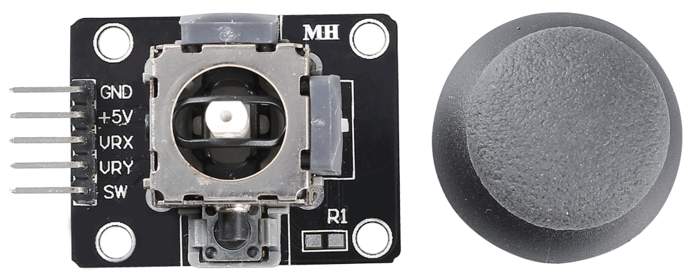
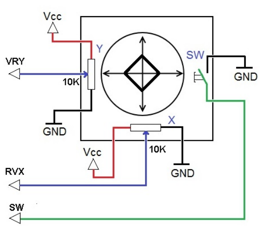

# Joystick Module

The basic idea of a joystick is to translate the movement of a stick into electronic information that a computer can process.

In order to communicate a full range of motion to the computer, a joystick needs to measure the stick's position on two axes - the X-axis (left to right) and the Y-axis (up and down). Just as in basic geometry, the X-Y coordinates pinpoint the stick's position exactly.

To determine the location of the stick, the joystick control system simply monitors the position of each shaft. The conventional analog joystick design does this with two potentiometers, or variable resistors.

The joystick also has a digital input that is actuated when the joystick is pressed down.

**Example**

- `joystick_mega` (Mega Board Project)

- `joystick_uno` (R3 Board Project)

- `13. GAME - Star-Crossed` (Scratch Project)

- `18. GAME - Kill Dragon` (Scratch Project)
