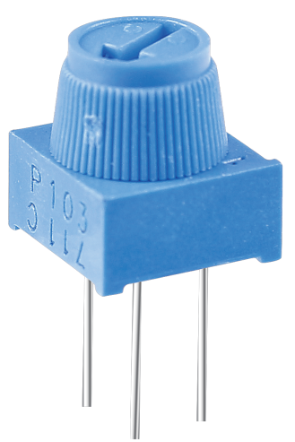
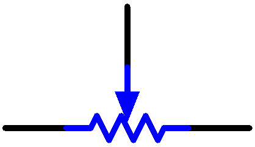

# Potentiometer

Potentiometer is also a resistance component with 3 terminals and its resistance value can be adjusted according to some regular variation.

Potentiometers come in various shapes, sizes, and values, but they all have the following things in common:

- They have three terminals (or connection points).

- They have a knob, screw, or slider that can be moved to vary the resistance between the middle terminal and either one of the outer terminals.

- The resistance between the middle terminal and either one of the outer terminals varies from 0 惟 to the maximum resistance of the pot as the knob, screw, or slider is moved.

Here is the circuit symbol of potentiometer.

The functions of the potentiometer in the circuit are as follows:

1.  Serving as a voltage divider

    > Potentiometer is a continuously adjustable resistor. When you adjust the shaft or sliding handle of the potentiometer, the movable contact will slide on the resistor. At this point, a voltage can be output depending on the voltage applied onto the potentiometer and the angle the movable arm has rotated to or the travel it has made.

2.  Serving as a rheostat

    > When the potentiometer is used as a rheostat, connect the middle pin and one of the other 2 pins in the circuit. Thus you can get a smoothly and continuously changed resistance value within the travel of the moving contact.

3.  Serving as a current controller

    > When the potentiometer acts as a current controller, the sliding contact terminal must be connected as one of the output terminals.

If you want to know more about potentiometer, refer to: [Potentiometer - Wikipedia](https://en.wikipedia.org/wiki/Potentiometer.)

**Example**

- `photoresistor_mega` (Mega Board Project)

- `photoresistor_uno` (R3 Board Project)

- `6. Moving Mouse` (Scratch Project)

- `16. GAME - Breakout Clone` (Scratch Project)
