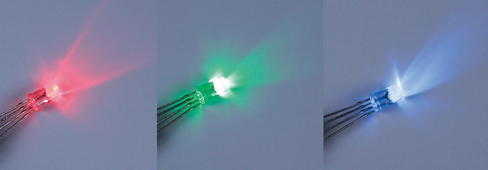
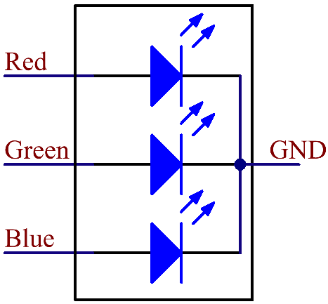
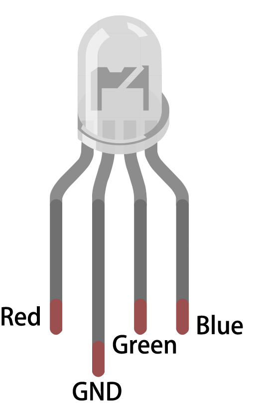

# RGB LED

RGB LEDs emit light in various colors. An RGB LED packages three LEDs of red, green, and blue into a transparent or semitransparent plastic shell. It can display various colors by changing the input voltage of the three pins and superimpose them, which, according to statistics, can create 16,777,216 different colors.

RGB LEDs can be categorized into common anode and common cathode ones. In this kit, the latter is used. The **common cathode**, or CC, means to connect the cathodes of the three LEDs. After you connect it with GND and plug in the three pins, the LED will flash the corresponding color.

Its circuit symbol is shown as figure.

An RGB LED has 4 pins: the longest one is GND; the others are Red, Green and Blue. Touch its plastic shell and you will find a cut. The pin closest to the cut is the first pin, marked as Red, then GND, Green and Blue in turn.

**Example**

- `rgb_mega` (Mega Board Project)

- `rgb_uno` (R3 Board Project)

- `4. Colorful Balls` (Scratch Project)
