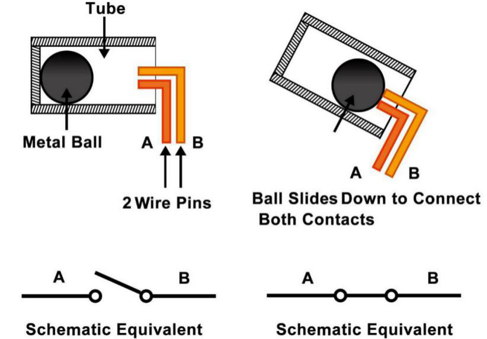

# Tilt Switch

The tilt switch used here is a ball one with a metal ball inside. It is used to detect inclinations of a small angle.

The principle is very simple. When the switch is tilted in a certain angle, the ball inside rolls down and touches the two contacts connected to the pins outside, thus triggering circuits. Otherwise the ball will stay away from the contacts, thus breaking the circuits.

- [SW520D Tilt Switch Datasheet](https://www.tme.com/Document/f1e6cedd8cb7feeb250b353b6213ec6c/SW-520D.pdf)

**Example**

- `tilt_mega` (Mega Board Project)

- `tilt_uno` (R3 Board Project)

- `8. Tumbler` (Scratch Project)
