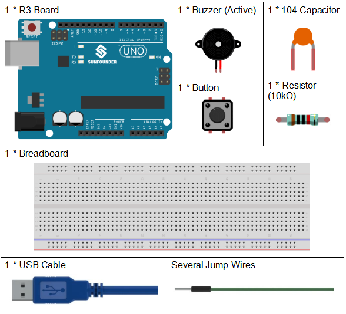
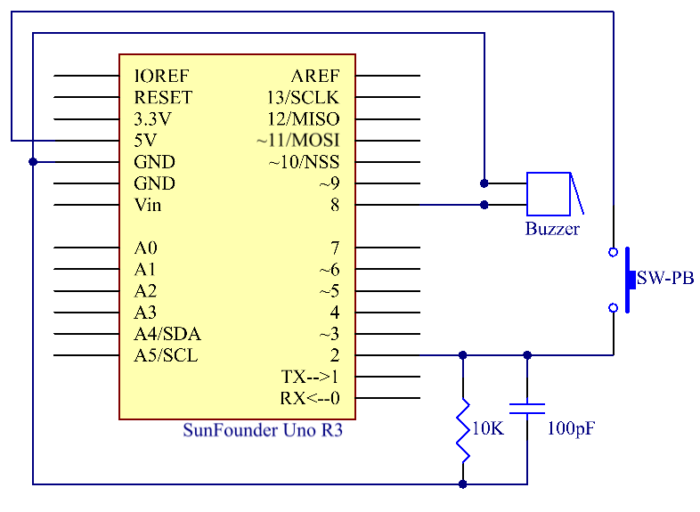
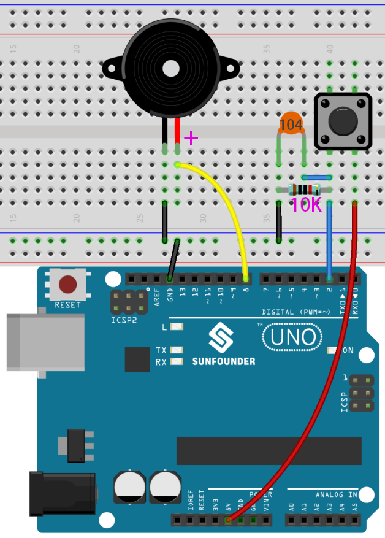
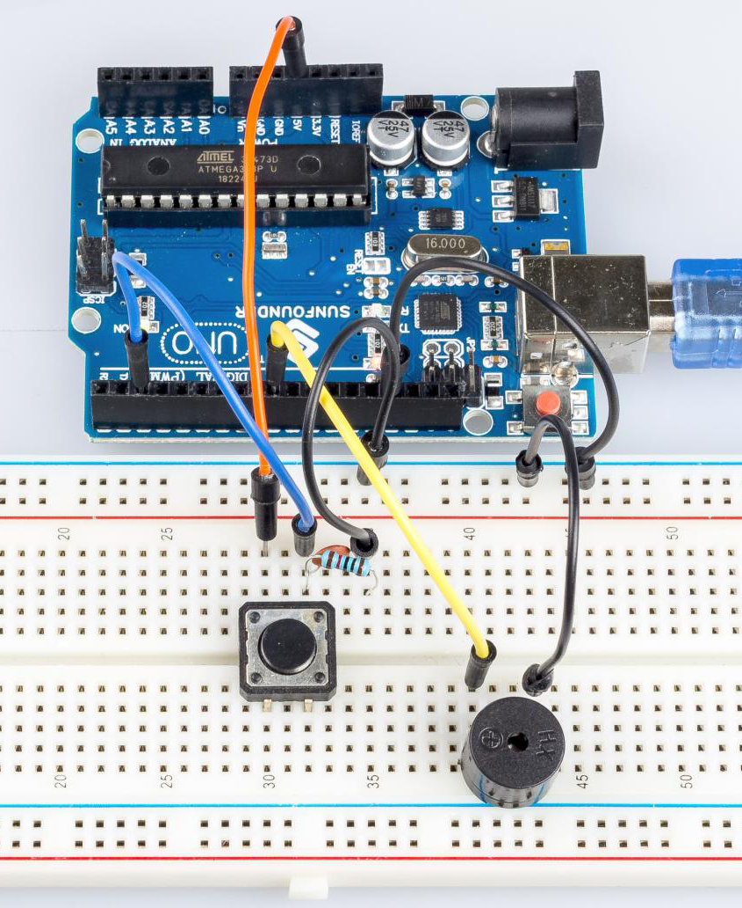

# Lesson 4 Doorbell


## Introduction


A buzzer is a great tool in your experiments whenever you want to make some sounds. In this lesson, we will learn how to drive an active buzzer to build a simple doorbell.


## Components





- `SunFounder R3 Board`

- `Breadboard`

- `Jumper Wires`

- `Resistor`

- `Capacitor`

- `Button`

- `Buzzer`


## Schematic Diagram





## Experimental Procedures


**Step 1:** Build the circuit (Long pins of buzzer is the Anode and the short pin is Cathode).





**Step 2:** Open the code file.


**Step 3:** Select the **Board** and **Port.**


**Step 4:** Upload the sketch to the board.


Now, you should hear the buzzer beep.





## Code


<iframe src=https://create.arduino.cc/editor/sunfounder01/4a3bfe94-a3bb-4b0c-afe6-9e740f470dc4/preview?embed style="height:510px;width:100%;margin:10px 0" frameborder=0></iframe>


## Code Analysis


**Define variables**


``` arduino

const int buttonPin = 2; //the button connect to pin2


const int buzzerPin = 8; //the led connect to pin8


/**********************************/


int buttonState = 0; //variable for reading the pushbutton status

```


Connect the button to pin 2 and buzzer to pin 8. Define a variable `buttonState` to restore the state of the button.


**Set the input and output status of the pins**


``` arduino

void setup()


{


    pinMode(buttonPin, INPUT); //initialize the buttonPin as input


    pinMode(buzzerPin, OUTPUT); //initialize the buzzerpin as output


}

```


We need to know the status of the button in this experiment, so here set the `buttonPin` as INPUT; to set HIGH/LOW of the buzzer, we set `buzzerPin` as OUTPUT.


**Read the status of the button**


``` arduino

buttonState = digitalRead(buttonPin);

```


buttonPin(Pin2) is a digital pin; here is to read the value of the button and store it in `buttonState`.


**digitalRead (Pin)**: Reads the value from a specified digital pin, either HIGH or LOW.


**Press the button to make the buzzer sound**


``` Arduino

if (buttonState == HIGH ) //When press the button, run the following code.

{ 

    for (i = 0; i < 50; i++) 

    /*When i=o, which accords with the condition i<=50, i++ equals to 1 

    (here in i = i + 1, the two "i"s are not the same, but i(now锛?= i锛坆efore锛?+ 1). 

    Run the code in the curly braces: let the buzzer beep for 3ms and stop for 3ms. 

    Then repeat 50 times.*/


    { 

        digitalWrite(buzzerPin, HIGH); //Let the buzzer beep.

        delay(3); //wait for 3ms

        digitalWrite(buzzerPin, LOW); //Stop the buzzer.

        delay(3); //wait for 3ms 

    }


    for (i = 0; i < 80; i++) //Let the buzzer beep for 5ms and stop for 5ms, repeat 80 times.

    { 

        digitalWrite(buzzerPin, HIGH);

        delay(5); //wait for 5ms

        digitalWrite(buzzerPin, LOW);

        delay(5); //wait for 5ms 

    }

}

```


In this part, when the **buttonState** is High level, then let the buzzer beeping in different frequency which can simulate the doorbell.
